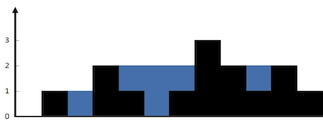
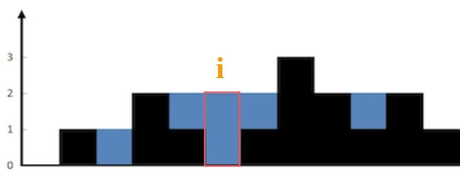
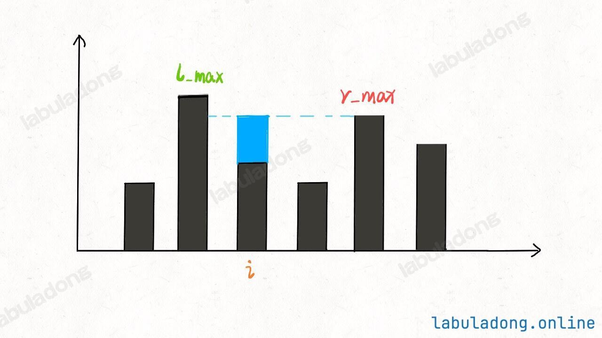

# 如何高效解决接雨水问题

### 42. Trapping Rain Water

Given `n` non-negative integers representing an elevation map where the width of each bar is `1`, compute how much water it can trap after raining.

**Example 1:**



**Input:** height = [0,1,0,2,1,0,1,3,2,1,2,1]
**Output:** 6
**Explanation:** The above elevation map (black section) is represented by array [0,1,0,2,1,0,1,3,2,1,2,1]. In this case, 6 units of rain water (blue section) are being trapped.

**Example 2:**

**Input:** height = [4,2,0,3,2,5]
**Output:** 9

**Constraints:**

* `n == height.length`
* $1 \leq n \leq 2 \times 10^4$
* $0 \leq$ `height[i]` $\leq 10^5$

## 核心思路

先不考虑整个柱状图能装多少水，仅仅考虑位置 `i` 这一个位置能装下多少水？



因为 `height[i]` 的高度为 0，而这里最多能盛 2 格水，$2-0=2$。因为位置 `i` 能达到的水柱高度和其左边的最高柱子、右边的最高柱子有关，分别称这两个柱子高度为 `l_max` 和 `r_max`；**位置 `i` 最大的水柱高度就是 `min(l_max, r_max)`**。

也就是说，对于位置 `i`，能够装的水为：

```cpp
water[i] = min(
    # 左边最高的柱子
    max(height[0..i]),  
    # 右边最高的柱子
    max(height[i..end]) 
) - height[i]
```




基于此分析，可以用如下代码实现

```cpp
class Solution {
public:
    int trap(vector<int>& height) {
        int n = height.size();
        int res = 0;
        for (int i = 1; i < n - 1; i++) {
            int l_max = 0, r_max = 0;
            // 找右边最高的柱子
            for (int j = i; j < n; j++)
                r_max = max(r_max, height[j]);
            // 找左边最高的柱子
            for (int j = i; j >= 0; j--)
                l_max = max(l_max, height[j]);
            // 如果自己就是最高的话，
            // l_max == r_max == height[i]
            res += min(l_max, r_max) - height[i];
        }
        return res;
    }
};
```

但是很明显算法复杂度达到了$O(n^2)$

## 备忘录优化

为了避免重复计算， **可以用两个数组 `r_max` 和 `l_max` 充当 cache，`l_max[i]` 表示位置 `i` 左边最高的柱子高度，`r_max[i]` 表示位置 `i` 右边最高的柱子高度**。预先把这两个数组计算好：

```cpp
#include <vector>
#include <algorithm>

class Solution {
public:
    int trap(vector<int>& height) {
        if (height.empty()) {
            return 0;
        }
        int n = height.size();
        int res = 0;
        // 数组充当备忘录
        vector<int> l_max(n);
        vector<int> r_max(n);
        // 初始化 base case
        l_max[0] = height[0];
        r_max[n - 1] = height[n - 1];
        // 从左向右计算 l_max
        for (int i = 1; i < n; i++)
            l_max[i] = max(height[i], l_max[i - 1]);
        // 从右向左计算 r_max
        for (int i = n - 2; i >= 0; i--)
            r_max[i] = max(height[i], r_max[i + 1]);
        // 计算答案
        for (int i = 1; i < n - 1; i++)
            res += min(l_max[i], r_max[i]) - height[i];
        return res;
    }
};
```

上述实现把时间复杂度降低为 $O(N)$，但是空间复杂度是 $O(N)$

## 双指针解法

为了降低空间复杂度，可以注意到上述cache的`l_max` 和 `r_max` 的当前值都只和上一个`index`的值相关，因此可以利用左右指针替代cache数组

```cpp
int trap(vector<int>& height) {
    int left = 0, right = height.size() - 1;
    int l_max = 0, r_max = 0;

    while (left < right) {
        l_max = max(l_max, height[left]);
        r_max = max(r_max, height[right]);
        // 此时 l_max 和 r_max 分别表示什么？
        left++; right--;
    }
}
```

对于这部分代码，**`l_max` 是 `height[0..left]` 中最高柱子的高度，`r_max` 是 `height[right..end]` 的最高柱子的高度**。

```cpp
class Solution {
public:
    int trap(vector<int>& height) {
        int left = 0, right = height.size() - 1;
        int l_max = 0, r_max = 0;

        int res = 0;
        while (left < right) {
            l_max = max(l_max, height[left]);
            r_max = max(r_max, height[right]);

            // res += min(l_max, r_max) - height[i]
            if (l_max < r_max) {
                res += l_max - height[left];
                left++;
            } else {
                res += r_max - height[right];
                right--;
            }
        }
        return res;
    }
};
```

上述实现代码的细节和使用cache存在一些差异：

之前的cache解法，`l_max[i]` 和 `r_max[i]` 分别代表 `height[0..i]` 和 `height[i..end]` 的最高柱子高度。

```cpp
res += Math.min(l_max[i], r_max[i]) - height[i];
```


而在双指针解法中，`l_max` 和 `r_max` 代表的是 `height[0..left]` 和 `height[right..end]` 的最高柱子高度。

```cpp
if (l_max < r_max) {
    res += l_max - height[left];
    left++; 
} 
```


此时的 `l_max` 是 `left` 指针左边的最高柱子，但是 `r_max` 并不一定是 `left` 指针右边最高的柱子。这是因为只有 `min(l_max, r_max)`才对最终结果有影响。**对于上图的情况， `l_max < r_max` 了， 但是`r_max` 是不是右边最大的并不影响 `height[i]` 能够装的水，因为`height[i]` 只和较低的 `l_max` 之差有关**：


## 扩展：盛最多水的容器

### 11. Container With Most Water

You are given an integer array height of length $n$. There are $n$ vertical lines drawn such that the two endpoints of the `i`th line are `(i, 0)` and `(i, height[i])`.

Find two lines that together with the x-axis form a container, such that the container contains the most water.

Return *the maximum amount of water a containe*r can store.

**Notice** that you may not slant the container.

**Example 1:**


**Input:** height = [1,8,6,2,5,4,8,3,7]
**Output:** 49
**Explanation:** The above vertical lines are represented by array [1,8,6,2,5,4,8,3,7]. In this case, the max area of water (blue section) the container can contain is 49.

**Example 2:**

**Input:** height = [1,1]
**Output:** 1

**Constraints:**

* `n == height.length`
* $2 \leq n \leq 10^5$
* $0\leq$ `height[i]` $\leq 10^4$

这题和问题**42**很类似。两道题的区别在于：**问题42给出的类似一幅直方图，每个横坐标都有宽度，而本题给出的每个横坐标是一条竖线，没有宽度**。

在问题42中，即使知道了 `height[left]` 和 `height[right]` 的高度，也不能算出 `left` 和 `right` 之间能够盛下多少水。这是因为`left` 和 `right` 之间每个柱子具体能盛多少水需要通过每个柱子的 `l_max` 和 `r_max` 来计算才行。

对于本题，如果知道了 `height[left]` 和 `height[right]` 的高度，就能算出 `left` 和 `right` 之间能够盛下多少水因为本题中竖线没有宽度。所以 `left` 和 `right` 之间能够盛的水就是：

```cpp
min(height[left], height[right]) * (right - left)
```

解决这道题的思路依然是双指针：

**用 `left` 和 `right` 两个指针从两端向中心收缩，一边收缩一边计算 `[left, right]` 之间的矩形面积，取最大的面积值即是答案**。

```cpp
#include <vector>
#include <algorithm>
using namespace std;

class Solution {
public:
    int maxArea(vector<int>& height) {
        int left = 0, right = height.size() - 1;
        int res = 0;
        while (left < right) {
            // [left, right] 之间的矩形面积
            int cur_area = min(height[left], height[right]) * (right - left);
            res = max(res, cur_area);
            // 双指针技巧，移动较低的一边
            if (height[left] < height[right]) {
                left++;
            } else {
                right--;
            }
        }
        return res;
    }
};
```

为什么要移动较低的一边：**因为矩形的高度是由 `min(height[left], height[right])` 即较低的一边决定的**。


