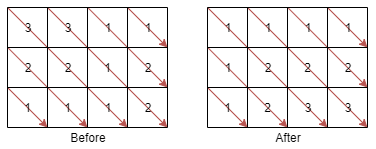
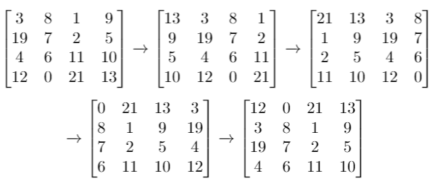

# 数组双指针经典习题

### 80. Remove Duplicates from Sorted Array II

Given an integer array `nums` sorted in non-decreasing order, remove some duplicates in-place such that each unique element appears **at most twice**. The relative order of the elements should be kept the same.

Since it is impossible to change the length of the array in some languages, you must instead have the result be placed in the first part of the array nums. More formally, if there are $k$ elements after removing the duplicates, then the first $k$ elements of nums should hold the final result. It does not matter what you leave beyond the first $k$ elements.

Return $k$ after placing the final result in the first $k$ slots of nums.

Do not allocate extra space for another array. You must do this by modifying the input array in-place with $O(1)$ extra memory.

Custom Judge:

The judge will test your solution with the following code:

```java
int[] nums = [...]; // Input array
int[] expectedNums = [...]; // The expected answer with correct length

int k = removeDuplicates(nums); // Calls your implementation

assert k == expectedNums.length;
for (int i = 0; i < k; i++) {
    assert nums[i] == expectedNums[i];
}
```

If all assertions pass, then your solution will be accepted.

Example 1:

Input: `nums = [1,1,1,2,2,3]`
Output: 5, `nums = [1,1,2,2,3,_]`
Explanation: Your function should return $k = 5$, with the first five elements of nums being 1, 1, 2, 2 and 3 respectively.
It does not matter what you leave beyond the returned k (hence they are underscores).
Example 2:

Input: `nums = [0,0,1,1,1,1,2,3,3]`
Output: 7, `nums = [0,0,1,1,2,3,3,_,_]`
Explanation: Your function should return $k = 7$, with the first seven elements of nums being 0, 0, 1, 1, 2, 3 and 3 respectively.
It does not matter what you leave beyond the returned $k$ (hence they are underscores).

Constraints:

- $1\leq$ `nums.length` $\leq3 \times 10^4$

- $-10^4 \leq$ `nums[i]` $\leq 10^4$

- `nums` is sorted in non-decreasing order.

#### Solution

这道题和除有序数组中的重复项解法非常类似，只不过这道题说重复两次以上的元素才需要被去除。

本题解法依然使用快慢指针技巧，在之前的解法中添加一个 count 变量记录每个数字重复出现的次数。

```cpp
class Solution {
public:
    int removeDuplicates(vector<int>& nums) {
        if (nums.size() == 0) {
            return 0;
        }
        // 快慢指针，维护 nums[0..slow] 为结果子数组
        int slow = 0, fast = 0;
        // 记录一个元素重复的次数
        int count = 0;
        while (fast < nums.size()) {
            if (nums[fast] != nums[slow]) {
                // 此时，对于 nums[0..slow] 来说，nums[fast] 是一个新的元素，加进来
                slow++;
                nums[slow] = nums[fast];
            } else if (slow < fast && count < 2) {
                // 此时，对于 nums[0..slow] 来说，nums[fast] 重复次数小于 2，也加进来
                slow++;
                nums[slow] = nums[fast];
            }
            fast++;
            count++;
            if (fast < nums.size() && nums[fast] != nums[fast - 1]) {
                // fast 遇到新的不同的元素时，重置 count
                count = 0;
            }
        }
        // 数组长度为索引 + 1
        return slow + 1;
    }
};
```

### 125. Valid Palindrome

A phrase is a palindrome if, after converting all uppercase letters into lowercase letters and removing all non-alphanumeric characters, it reads the same forward and backward. Alphanumeric characters include letters and numbers.

Given a string `s`, return `true` if it is a palindrome, or false otherwise.

Example 1:

Input: `s = "A man, a plan, a canal: Panama"`
Output: `true`
Explanation: `"amanaplanacanalpanama"` is a palindrome.
Example 2:

Input: `s = "race a car"`
Output: `false`
Explanation: `"raceacar"` is not a palindrome.
Example 3:

Input: `s = " "`
Output: `true`
Explanation: `s` is an empty string `""` after removing non-alphanumeric characters.
Since an empty string reads the same forward and backward, it is a palindrome.

Constraints:

- $1 \leq$ `s.length` $\leq 2 \times 10^5$

- `s` consists only of printable `ASCII` characters.

#### 基本思路

这道题很简单，只要先把所有字符转化成小写，并过滤掉空格和标点这类字符，然后对剩下的字符执行两端向中心的双指针算法即可。

```cpp
static inline bool isPalindrome(std::string s)
    {
        ssize_t left = 0;
        auto right = ssize(s) - 1;

        auto to_uppercase = [](char& c)
        {
            if(c >= 'a' && c <='z')
            {
                return true;
            }

            if(c>='A' && c<='Z')
            {
                c+=32;
                return true;
            }

            if(c>='0' && c<='9')
            {
                return true;
            }

            return false;
        };

        while(left <= right)
        {
            while(left <= right && !to_uppercase(s[left]))
            {
                ++left;
            }
            while(left <= right && !to_uppercase(s[right]))
            {
                --right;
            }

            if(left > right)
            {
                //after removing all non-alphanumeric characters
                //the string becomes empty
                return true;
            }

            if(s[left] != s[right])
            {
             return false;
            }

            ++left;
            --right;
        }

        return true;
    }
```

### 75. Sort Colors

You are given an array `nums` with n objects colored `red`, `white`, or `blue`, sort them **in-place** so that objects of the same color are adjacent, with the colors in the order `red`, `white`, and `blue`.

We will use the integers 0, 1, and 2 to represent the color `red`, `white`, and `blue`, respectively.

You must solve this problem without using the library's sort function.

Example 1:

Input: `nums = [2,0,2,1,1,0]`

Output: `[0,0,1,1,2,2]`

Explanation:

The array has two 0s, two 1s, and two 2s. Sorting them in-place places all 0s first, then all 1s, then all 2s.

Example 2:

Input: `nums = [2,0,1]`

Output: `[0,1,2]`

Explanation:

The array has one each of 0, 1, and 2, arranged in-place in the order 0, 1, 2.

Constraints:

- `n == nums.length`

- `1 <= n <= 300`

- `nums[i]` is either 0, 1, or 2.

Follow up: Could you come up with a one-pass algorithm using only constant extra space?

#### 基本思路

三种元素的分类问题，可以在左右分别用指针 `p0`, `p2` 维护 0 的区间和 2 的区间，让第三个指针 `p` 遍历数组，把遇到的元素分类到左右两个区间中，最后中间剩下的也就是元素 1 了。

```cpp
 static inline void sortColors(vector<int>& nums)
    {
        ssize_t l = 0;
        ssize_t mid = 0;
        ssize_t r = ssize(nums) - 1;

        while(mid <= r)
        {
            if(nums[mid] == 0)
            {
                //move zero to left side
                swap(nums[l], nums[mid]);
                ++mid;
                ++l;
            }
            else if(nums[mid] == 1)
            {
                //keep one at current place
                ++mid;
            }
            else if(nums[mid] == 2)
            {
                //move two to right side
                swap(nums[mid], nums[r]);
                --r;
                //don't move mid as we need to keep updating mid
            }
        }
    }
```

### 88. Merge Sorted Array

You are given two integer arrays `nums1` and `nums2`, sorted in **non-decreasing order**, and two integers $m$ and $n$, representing the number of elements in `nums1` and `nums2` respectively.

Merge `nums1` and nums2 into a single array sorted in non-decreasing order.

The final sorted array should not be returned by the function, but instead be stored inside the array `nums1`. To accommodate this, `nums1` has a length of $m + n$, where the first $m$ elements denote the elements that should be merged, and the last $n$ elements are set to 0 and should be ignored. `nums2` has a length of n.

Example 1:

Input: `nums1 = [1,2,3,0,0,0]`, `m = 3`, `nums2 = [2,5,6]`, `n = 3`
Output: `[1,2,2,3,5,6]`
Explanation: The arrays we are merging are `[1,2,3]` and `[2,5,6]`.
The result of the merge is `[1,2,2,3,5,6]` with the underlined elements coming from `nums1`.

Example 2:

Input: `nums1 = [1]`, `m = 1`, `nums2 = []`, `n = 0`
Output: `[1]`
Explanation: The arrays we are merging are `[1]` and `[]`.
The result of the merge is `[1]`.

Example 3:

Input: `nums1 = [0]`, `m = 0`, `nums2 = [1]`, `n = 1`
Output: `[1]`
Explanation: The arrays we are merging are `[]` and `[1]`.
The result of the merge is `[1]`.
Note that because `m = 0`, there are no elements in `nums1`. The `0` is only there to ensure the merge result can fit in `nums1`.

Constraints:

* `nums1.length == m + n`
* `nums2.length == n`
* $0 \leq m, n \leq 200$
* $1 \leq m + n \leq 200$
* $-10^9 \leq$ `nums1[i]`, `nums2[j]` $\leq 10^9$

Follow up: Can you come up with an algorithm that runs in $O(m + n)$ time?

#### 基本思路

题目要求把结果存到 `nums1` 中，而 `nums1` 的开头有元素，如果直接复制会覆盖掉 `nums1` 的原始元素，导致错误。

但 `nums1` 后面是空的，所以这道题需要稍微变通一下：将双指针初始化在数组的尾部，然后从后向前进行合并，这样即便覆盖了 `nums1 `中的元素，这些元素也必然早就被用过了，不会影响答案的正确性。

```cpp
class Solution {
public:
    void merge(vector<int>& nums1, int m, vector<int>& nums2, int n) {
        // 两个指针分别初始化在两个数组的最后一个元素（类似拉链两端的锯齿）
        int i = m - 1, j = n - 1;
        // 生成排序的结果（类似拉链的拉锁）
        int p = nums1.size() - 1;
        // 从后向前生成结果数组，类似合并两个有序链表的逻辑
        while (i >= 0 && j >= 0) {
            if (nums1[i] > nums2[j]) {
                nums1[p] = nums1[i];
                i--;
            } else {
                nums1[p] = nums2[j];
                j--;
            }
            p--;
        }
        // 可能其中一个数组的指针走到尽头了，而另一个还没走完
        // 因为我们本身就是在往 nums1 中放元素，所以只需考虑 nums2 是否剩元素即可
        while (j >= 0) {
            nums1[p] = nums2[j];
            j--;
            p--;
        }
    }
};
```

### 977. Squares of a Sorted Array

Given an integer array `nums` sorted in **non-decreasing order**, return an array of the squares of each number sorted in non-decreasing order.

Example 1:

Input: `nums = [-4,-1,0,3,10]`
Output: `[0,1,9,16,100]`
Explanation: After squaring, the array becomes `[16,1,0,9,100]`.
After sorting, it becomes `[0,1,9,16,100]`.
Example 2:

Input: nums = `[-7,-3,2,3,11]`
Output: `[4,9,9,49,121]`

**Constraints**:

* $1\leq$ `nums.length` $\leq 10^4$
* $-10^4 \leq$ `nums[i]` $\leq 10^4$
* `nums` is sorted in non-decreasing order.

*Follow up*: Squaring each element and sorting the new array is very trivial, could you find an $O(n)$ solution using a different approach?

#### 基本思路

平方的特点是会把负数变成正数，所以一个负数和一个正数平方后的大小要根据绝对值来比较。可以把元素 0 作为分界线，0 左侧的负数是一个有序数组 `nums1`，0 右侧的正数是另一个有序数组 `nums2`，那么这道题就和合并两个有序数组 差不多，所以，我们可以去寻找正负数的分界点，然后向左右扩展，执行合并有序数组的逻辑。

不过还有个更好的办法，不用找正负分界点，而是直接将双指针分别初始化在 `nums` 的开头和结尾，相当于合并两个从大到小排序的数组

```cpp
class Solution {
public:
    vector<int> sortedSquares(vector<int>& nums) {
        int n = nums.size();
        // 两个指针分别初始化在正负子数组绝对值最大的元素索引
        int i = 0, j = n - 1;
        // 得到的有序结果是降序的
        int p = n - 1; //must starting from the end of the result array
        vector<int> res(n);
        // 执行双指针合并有序数组的逻辑
        while (i <= j) {
            if (abs(nums[i]) > abs(nums[j])) {
                res[p] = nums[i] * nums[i];
                i++;
            } else {
                res[p] = nums[j] * nums[j];
                j--;
            }
            p--;
        }
        return res;
    }
};
```

### 1329. Sort the Matrix Diagonally

A **matrix diagonal** is a diagonal line of cells starting from some cell in either the topmost row or leftmost column and going in the bottom-right direction until reaching the matrix's end. For example, the **matrix diagonal** starting from `mat[2][0]`, where mat is a `6 x 3` matrix, includes cells `mat[2][0]`, `mat[3][1]`, and `mat[4][2]`.

Given an `m x n` matrix mat of integers, sort each matrix diagonal in ascending order and return the resulting matrix.

**Example 1**:



Input: `mat = [[3,3,1,1],[2,2,1,2],[1,1,1,2]]`
Output: `[[1,1,1,1],[1,2,2,2],[1,2,3,3]]`

**Example 2**:

Input: `mat = [[11,25,66,1,69,7],[23,55,17,45,15,52],[75,31,36,44,58,8],[22,27,33,25,68,4],[84,28,14,11,5,50]]`
Output: `[[5,17,4,1,52,7],[11,11,25,45,8,69],[14,23,25,44,58,15],[22,27,31,36,50,66],[84,28,75,33,55,68]]`

**Constraints**:

* `m == mat.length`
* `n == mat[i].length`
* `1 <= m, n <= 100`
* `1 <= mat[i][j] <= 100`

#### 基本思路

这题按照对角线操作二维数组是需要技巧的，即如何快速判断两个元素坐标是否在同一个对角线上？

在同一个对角线上的元素，其横纵坐标之差是相同的。有了这个规律辅助，这道题就很容易做了，直接用一个哈希表把每个对角线的元素存起来，想办法排序，最后放回二维矩阵上即可。

如何排序数组呢？借助有序数据结构或者用标准库的排序函数都行，考虑到数组的操作效率，需要从最后删除元素。

```cpp
class Solution {
public:
    vector<vector<int>> diagonalSort(vector<vector<int>>& mat) {
        int m = mat.size(), n = mat[0].size();

        // 存储所有对角线的元素列表
        unordered_map<int, list<int>> diagonals;

        for (int i = 0; i < m; i++) {
            for (int j = 0; j < n; j++) {
                // 横纵坐标之差可以作为一条对角线的 ID
                int diagonalID = i - j;
                diagonals[diagonalID].push_back(mat[i][j]);
            }
        }

        // 从数组末尾删除元素效率较高，所以我们把 ArrayList 倒序排序
        for (auto& diagonal : diagonals) {
            diagonal.second.sort(greater<int>());
        }

        // 把排序结果回填二维矩阵
        for (int i = 0; i < m; i++) {
            for (int j = 0; j < n; j++) {
                list<int>& diagonal = diagonals[i - j];
                mat[i][j] = diagonal.back();
                diagonal.pop_back();
            }
        }

        return mat;
    }
};
```

### 1260. Shift 2D Grid

Given a 2D grid of size $m \times n$ and an integer $k$. You need to shift the grid $k$ times.

In one shift operation:

* Element at `grid[i][j]` moves to `grid[i][j + 1]`.
* Element at `grid[i][n - 1]` moves to `grid[i + 1][0]`.
* Element at `grid[m - 1][n - 1]` moves to `grid[0][0]`.

Return the 2D grid after applying shift operation `k` times.

**Example 1:**


**Input:** `grid` = [[1,2,3],[4,5,6],[7,8,9]], k = 1
**Output:** [[9,1,2],[3,4,5],[6,7,8]]

**Example 2:**



**Input:** `grid` = [[3,8,1,9],[19,7,2,5],[4,6,11,10],[12,0,21,13]], k = 4
**Output:** [[12,0,21,13],[3,8,1,9],[19,7,2,5],[4,6,11,10]]

**Example 3:**

**Input:** `grid` = [[1,2,3],[4,5,6],[7,8,9]], k = 9
**Output:** [[1,2,3],[4,5,6],[7,8,9]]

**Constraints:**

* `m == grid.length`
* `n == grid[i].length`
* `1 <= m <= 50`
* `1 <= n <= 50`
* `-1000 <= grid[i][j] <= 1000`
* `0 <= k <= 100`

#### 基本思路

写一个 get 方法和 set 方法把二维数组抽象成一维数组，然后题目就变成了让你将一个一维的数组平移 `k` 位，相当于把前 `mn - k` 个元素的位置和后 `k` 个元素的位置对调，也可以分别翻转前 `mn - k` 个元素和后 `k` 个元素，最后反转所有元素，得到的结果就是题目想要的。

```cpp
class Solution {
public:
    vector<vector<int>> shiftGrid(vector<vector<int>>& grid, int k) {
        // 把二维 grid 抽象成一维数组
        int m = grid.size(), n = grid[0].size();
        int mn = m * n;
        k = k % mn;
        // 先把最后 k 个数翻转
        reverse(grid, mn - k, mn - 1);
        // 然后把前 mn - k 个数翻转
        reverse(grid, 0, mn - k - 1);
        // 最后把整体翻转
        reverse(grid, 0, mn - 1);

        return grid;
    }

    // 通过一维数组的索引访问二维数组的元素
    int get(vector<vector<int>>& grid, int index) {
        int n = grid[0].size();
        int i = index / n, j = index % n;
        return grid[i][j];
    }

    // 通过一维数组的索引修改二维数组的元素
    void set(vector<vector<int>>& grid, int index, int val) {
        int n = grid[0].size();
        int i = index / n, j = index % n;
        grid[i][j] = val;
    }

    // 翻转一维数组的索引区间元素
    void reverse(vector<vector<int>>& grid, int i, int j) {
        while (i < j) {
            int temp = get(grid, i);
            set(grid, i, get(grid, j));
            set(grid, j, temp);
            i++;
            j--;
        }
    }
};
```

### 14. Longest Common Prefix

Write a function to find the longest common prefix string amongst an array of strings.

If there is no common prefix, return an empty string `""`.

**Example 1:**

**Input:** strs = ["flower","flow","flight"]
**Output:** "fl"

**Example 2:**

**Input:** strs = ["dog","racecar","car"]
**Output:** ""
**Explanation:** There is no common prefix among the input strings.

**Constraints:**

- `1 <= strs.length <= 200`
- `0 <= strs[i].length <= 200`
- `strs[i]` consists of only lowercase English letters if it is non-empty.

#### 基本思路

把字符串列表看成一个二维数组，然后用一个嵌套 for 循环计算这个二维数组前面有多少列的元素完全相同即可。

```cpp
class Solution {
public:
    string longestCommonPrefix(vector<string>& strs) {
        int m = strs.size();
        // 以第一行的列数为基准
        int n = strs[0].length();
        for (int col = 0; col < n; col++) {
            for (int row = 1; row < m; row++) {
                string thisStr = strs[row], prevStr = strs[row - 1];
                // 判断每个字符串的 col 索引是否都相同
                if (col >= thisStr.length() || col >= prevStr.length() || thisStr[col] != prevStr[col]) {
                    // 发现不匹配的字符，只有 strs[row][0..col-1] 是公共前缀
                    return strs[row].substr(0, col);
                }
            }
        }
        return strs[0];
    }
};
```
